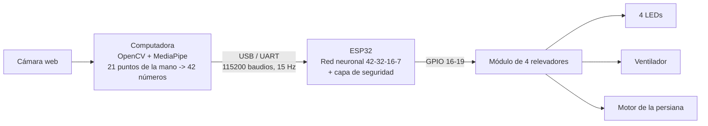

# Control de iluminación, ventilación y persiana por gestos de mano con una red neuronal en ESP32

Prototipo que reconoce gestos de la mano con una cámara y usa una **red neuronal** para encender o apagar un foco (4 LEDs), un ventilador y una persiana motorizada, a través de un módulo de relevadores. La red neuronal propia del proyecto (perceptrón multicapa 42-32-16-7) se entrena en Python y se ejecuta **dentro del ESP32**, escrita en C.

Proyecto desarrollado como Producto Integrador de Aprendizaje (PIA) de la materia **Inteligencia Artificial y Redes Neuronales**, Facultad de Ingeniería Mecánica y Eléctrica (FIME), Universidad Autónoma de Nuevo León (UANL).

> **Video de demostración: https://youtu.be/hHIyqdtZdU0?si=kThgcKXxdezmG71S
---

## Cómo funciona



1. **En la computadora:** OpenCV captura la imagen y MediaPipe (HandLandmarker) detecta 21 puntos de la mano. Se toman sus coordenadas `(x, y)`, se restan respecto a la muñeca y se dividen entre el tamaño de la mano. Resultado: 42 números que no dependen de la posición ni de la distancia. **No se normaliza la rotación**, porque la orientación es lo que distingue algunos gestos.
2. **Por USB:** la computadora envía una línea de texto con los 42 valores, 15 veces por segundo (o la letra `N` si no hay mano).
3. **En el ESP32:** la red neuronal calcula la clase del gesto. Una capa de seguridad (umbral de confianza, estabilidad e interbloqueo del motor) decide si se acepta la lectura, y el relevador correspondiente se activa según la clase.

### Gestos y acciones

| Clase | Gesto | Acción | Relevador |
|:-:|---|---|:-:|
| 0 | Ninguno (sin gesto o sin mano) | No hace nada | — |
| 1 | Mano abierta | Encender foco | IN1 |
| 2 | Puño cerrado | Apagar foco | IN1 |
| 3 | Pulgar hacia la izquierda | Abrir persiana | IN3 |
| 4 | Pulgar hacia la derecha | Cerrar persiana | IN4 |
| 5 | Índice hacia arriba | Encender ventilador | IN2 |
| 6 | Índice hacia abajo | Apagar ventilador | IN2 |

La imagen se muestra en modo espejo: «izquierda» es hacia la izquierda de la pantalla. La clase 0 es importante: sin ella, cualquier mano se clasificaría como un gesto y activaría cargas por error.

---

## Hardware

| Componente | Descripción |
|---|---|
| Microcontrolador | ESP32 DevKit V1 de 30 pines con USB-C |
| Cámara | Cámara web Game Factor WG400 (FHD) |
| Relevadores | Módulo genérico de 4 relevadores de 5 V para Arduino (activo en nivel bajo) |
| Foco | 4 LEDs en paralelo, cada uno con resistencia de 330 Ω |
| Ventilador y persiana | Dos motores de corriente directa de 5 V |
| Computadora | Dell Latitude 5420 (captura, MediaPipe y envío de datos) |
| Alimentación | ESP32 por USB; LEDs a 5 V |

### Conexiones

| ESP32 | Módulo de relevadores | Función |
|---|---|---|
| GPIO 16 | IN1 | Foco |
| GPIO 17 | IN2 | Ventilador |
| GPIO 18 | IN3 | Persiana: abrir |
| GPIO 19 | IN4 | Persiana: cerrar |
| VIN (5 V) | VCC | Alimentación del módulo |
| GND | GND | Referencia común |


*Esquema de referencia: la placa dibujada es un ESP32-S3; el prototipo usa un ESP32 DevKit V1 con los mismos GPIO 16 a 19. El diagrama muestra solo el lado de control.*

**Lado de las cargas** (contactos de cada relevador: COM, NO y NC):

- **Foco:** positivo de la fuente a COM1; NO1 a cuatro ramas en paralelo (resistencia de 330 Ω + LED); cátodos a GND.
- **Ventilador:** positivo a COM2; NO2 al ventilador; el otro borne del ventilador a GND.
- **Persiana (motor de CC reversible con dos relevadores):** COM3 a un borne del motor y COM4 al otro; NO3 y NO4 al positivo de la fuente del motor; NC3 y NC4 a GND. En reposo, ambos bornes del motor quedan a GND y no gira; si cambia el sentido de giro, intercambia los cables del motor.

> Todas las tierras (ESP32, módulo y fuentes de las cargas) deben estar unidas.

---

## Software y requisitos

**En la computadora**

- Python 3.10 a 3.12 (recomendado para MediaPipe)
- Paquetes: `opencv-python`, `mediapipe`, `pyserial`, `numpy`, `scikit-learn`, `matplotlib`
- Internet la primera vez: MediaPipe descarga el modelo `hand_landmarker.task`

**Para el ESP32**

- [ESP-IDF](https://docs.espressif.com/projects/esp-idf/) v6.1 (versión con la que se compiló y probó)

---

**Dentro del zip:**

| Archivo | Para qué sirve |
|---|---|
| `comun.py` | Detector de manos (MediaPipe), extracción de las 42 características y lista de clases |
| `recolectar.py` | Graba el conjunto de datos propio (`datos.csv`) |
| `entrenar.py` | Entrena la red, evalúa y exporta los pesos a `nn_pesos.h`; genera `matriz_confusion.png` y `curva_perdida.png` |
| `ejecutar.py` | Lee la cámara y envía los datos al ESP32 |
| `verificar_esp32.py` | Comprueba que el ESP32 reproduce lo que calcula Python con tus datos |
| `main.c` | Firmware del ESP32: red neuronal, capa de seguridad y control de relevadores |
| `nn_pesos.h` | Pesos de la red (generado por `entrenar.py`)
| `datos.csv` | Conjunto de datos grabado 

---

## Cómo reproducirlo

### 1. Preparar la computadora

```bash
python -m venv venv
venv\Scripts\activate          # Linux/Mac: source venv/bin/activate
pip install opencv-python mediapipe pyserial numpy scikit-learn matplotlib
```

Descomprime el zip y trabaja desde esa carpeta.

### 2. Grabar el conjunto de datos

```bash
python recolectar.py
```

- Teclas `0` a `6`: elige la clase. `ESPACIO`: graba o pausa. `ESC`: guarda en `datos.csv` y sale (si cierras la ventana de otra forma, se pierde lo grabado).
- Graba unas 300 a 700 muestras por clase moviendo la mano (distancia, ángulo y posición), y procura que las clases queden equilibradas.
- Graba la clase 0 con la mano relajada, en transición entre gestos y en movimiento.
- Las muestras nuevas se **agregan** a `datos.csv`. Para empezar de cero, borra o renombra ese archivo.

### 3. Entrenar

```bash
python entrenar.py
```

Muestra el conteo por clase, la exactitud en prueba, la matriz de confusión y el reporte por clase, y genera `nn_pesos.h`.

### 4. Cargar el ESP32

1. Copia `main.c` y `nn_pesos.h` a la carpeta `main/` de un proyecto de ESP-IDF (borra el `.c` de ejemplo).
2. Comprueba que `main/CMakeLists.txt` diga: `idf_component_register(SRCS "main.c" INCLUDE_DIRS ".")`.
3. Compila y carga (con el ESP32 conectado y **sin monitor serial abierto**):

```bash
idf.py build
idf.py -p COM5 flash
```

Cada vez que vuelvas a entrenar, copia el nuevo `nn_pesos.h` y vuelve a cargar el ESP32.

### 5. Ejecutar el sistema

1. Cierra el monitor serial de ESP-IDF (ocupa el puerto).
2. En `ejecutar.py`, ajusta `PUERTO` al puerto de tu ESP32 (por ejemplo `COM5`).
3. Ejecuta:

```bash
python ejecutar.py
```

Se abre la ventana de la cámara con la respuesta del ESP32, por ejemplo `C:5 P:0.97 R:0100`: `C` es la clase, `P` la confianza de la red y `R` el estado de los relevadores (foco, ventilador, abrir, cerrar). `ESC` para salir.

### 6. (Opcional) Verificar la red del ESP32

```bash
python verificar_esp32.py COM5 300
```

Envía muestras de `datos.csv` al ESP32 y compara su clase y confianza con las que calcula Python a partir de `nn_pesos.h`. Los relevadores no se activan durante la prueba. Requiere que el ESP32 tenga cargado el mismo `nn_pesos.h`.

---

## Parámetros ajustables (`main.c`)

| Parámetro | Valor | Función |
|---|---|---|
| `ACTIVE_LEVEL` | 0 | Nivel de activación del módulo de relevadores (0 = activo en bajo, 1 = activo en alto) |
| `UMBRAL` | 0.85 | Probabilidad mínima de la clase ganadora; si es menor, la lectura se descarta |
| `ESTABLE` | 5 lecturas | Lecturas seguidas iguales (unos 0.33 s a 15 Hz) antes de aceptar un gesto |
| `VENTANA_MS` | ajustable | Tiempo máximo de movimiento de la persiana por gesto; ajústalo a lo que tarda tu persiana (en el prototipo, unos 2.5 s) |
| `TIEMPO_MUERTO_MS` | 300 ms | Pausa con ambos relevadores apagados antes de invertir el sentido del motor |

Cada gesto actúa una sola vez al cambiar; para repetirlo, baja la mano o vuelve a «ninguno».

---

## Resultados

Red 42-32-16-7 (2 023 parámetros) entrenada con scikit-learn (`MLPClassifier`, Adam, ReLU, regularización L2, parada temprana). El conjunto se divide 80 % entrenamiento y 20 % prueba; solo el entrenamiento se aumenta con giros de ±10°, cambios de tamaño de ±10 % y ruido (sin espejar la mano).

| Iteración | Muestras | Muestras de prueba | Exactitud | Errores |
|:-:|:-:|:-:|:-:|:-:|
| 1 | 5 171 | 1 035 | 97.20 % | 29 |
| 2 (final) | 4 885 | 977 | **99.90 %** | 1 |

En la segunda iteración, el único error fue un puño clasificado como «ninguno». La mejora respecto a la primera (donde se confundían «pulgar derecha» e «índice arriba») coincide con haber grabado un conjunto más equilibrado.


> **Importante:** las muestras de prueba salen de las mismas sesiones de grabación que las de entrenamiento, y los fotogramas consecutivos son muy parecidos, por lo que el 99.90 % es probablemente optimista. Los datos se grabaron con ambas manos de **una sola persona** y no se evaluó con sesiones independientes.

---

## Seguridad

- Si usas cargas de corriente alterna, utiliza un módulo con optoacoplador y un aislamiento adecuado, y **no manipules el cableado con la carga energizada**.
- La persiana usa dos relevadores, uno por sentido. El programa nunca los activa a la vez, pero conviene añadir interruptores de final de carrera en el cableado.
- Comprueba que la fuente aguante el consumo de las bobinas y de los motores: si el ESP32 se reinicia al activar una carga, alimenta el módulo de relevadores y los motores con una fuente externa (con GND común).

## Limitaciones y trabajo futuro

- Depende de una computadora para la cámara y MediaPipe; solo la red neuronal corre en el ESP32.
- Probado con una sola persona y condiciones de iluminación similares.
- Mejoras: evaluar con sesiones y personas independientes, más ejemplos de gestos parecidos, finales de carrera para la persiana y una versión autónoma con una placa con cámara (por ejemplo ESP32-CAM) y una red que trabaje sobre la imagen.

---

## Autores

Equipo 07, Grupo 007. FIME, UANL.

- Cristopher Nigro Treviño
- Jesus Jaime Salazar Martinez
- Edwin Omar Guerrero Rosales

Asesor: Dr. Erick de Jesús Ordaz Rivas.

## Créditos y licencia

Proyecto construido con [MediaPipe](https://ai.google.dev/edge/mediapipe), [OpenCV](https://opencv.org/), [scikit-learn](https://scikit-learn.org/), [NumPy](https://numpy.org/) y [ESP-IDF](https://docs.espressif.com/projects/esp-idf/)
